# Vela Mobile Customer Portal

A frontend-only telecom account portal for reviewing a mobile line, checking data usage, choosing a plan, and handling support requests. The interface uses sample customer and carrier data.

## Pages and workflows

- **Overview:** Review the active line, data allowance, current plan, next bill, and open support cases. Open the sample statement, inspect the saved demo payment method, toggle AutoPay, or record a sample payment. No payment is processed.
- **Data usage:** Filter usage sessions by time range and activity type, sort the list, review the usage breakdown, toggle the alert preference, and download a CSV summary.
- **Plans:** Compare three plans, switch plans through a confirmation dialog, add or remove optional extras, and see the estimated monthly total update. The overview and usage pages use the selected plan during the current session.
- **Support:** Search cases and filter them by status, download a case history, submit a validated request, read a case, reply, mark a case resolved, or remove it through a custom confirmation dialog. A reply moves the case to In progress.

Dialogs provide keyboard focus handling, a safe initial action, and clear cancel and confirmation actions. Changes show in-page toast feedback and update shared React state while the app remains open.

## Demo data and limits

This is a frontend-only demonstration. Sample account, bill, usage, plan, and support records are held in React state in the browser session. They are not saved to local or session storage, a server, or a carrier account. Refreshing the page resets changes. The app does not process payments, contact carrier support, or send real notifications.

## Run locally

```sh
npm install
npm run dev
```

Run the project checks and build with:

```sh
npm run lint
npm run build
```

On Windows PowerShell, use `npm.cmd` in place of `npm` if required by the local execution policy.

## Deployment

The app is published with the package script `npm run deploy`. It builds the Vite app, adds the GitHub Pages single-page route fallback, and publishes the `dist` folder to the `gh-pages` branch.

Live app: [https://a2rp.github.io/telecom-customer-portal/](https://a2rp.github.io/telecom-customer-portal/)

## Screenshots

The screenshots below were captured from the local production build and show the actual app UI.

### Pages

| Page | Screenshot |
| --- | --- |
| Account overview | 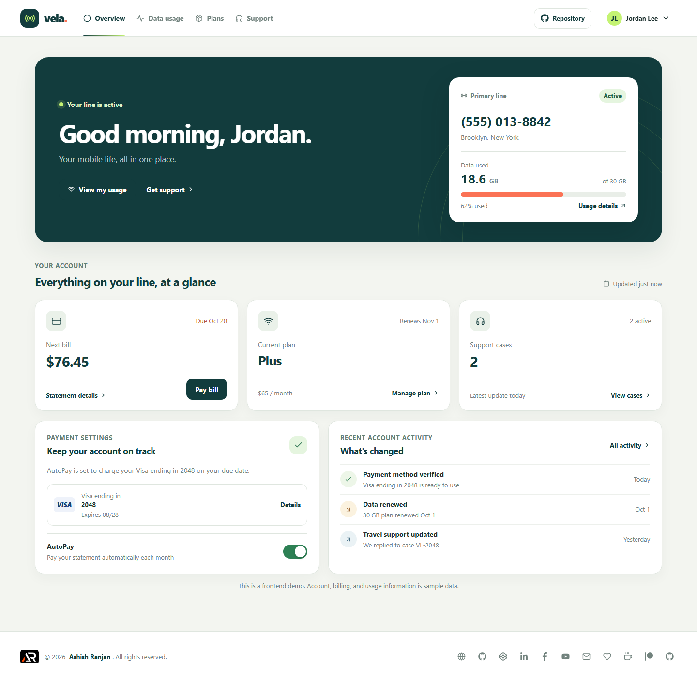 |
| Data usage | 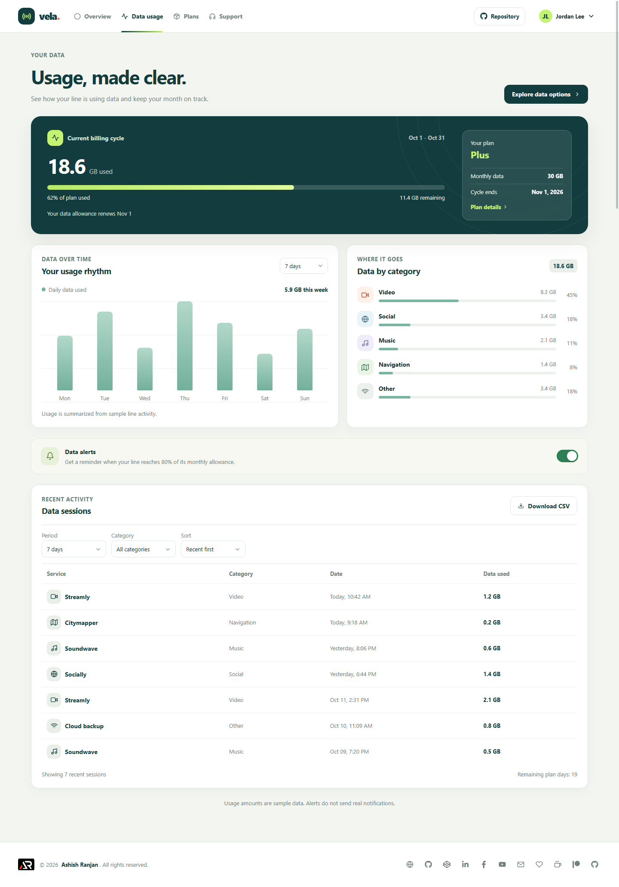 |
| Plan comparison | 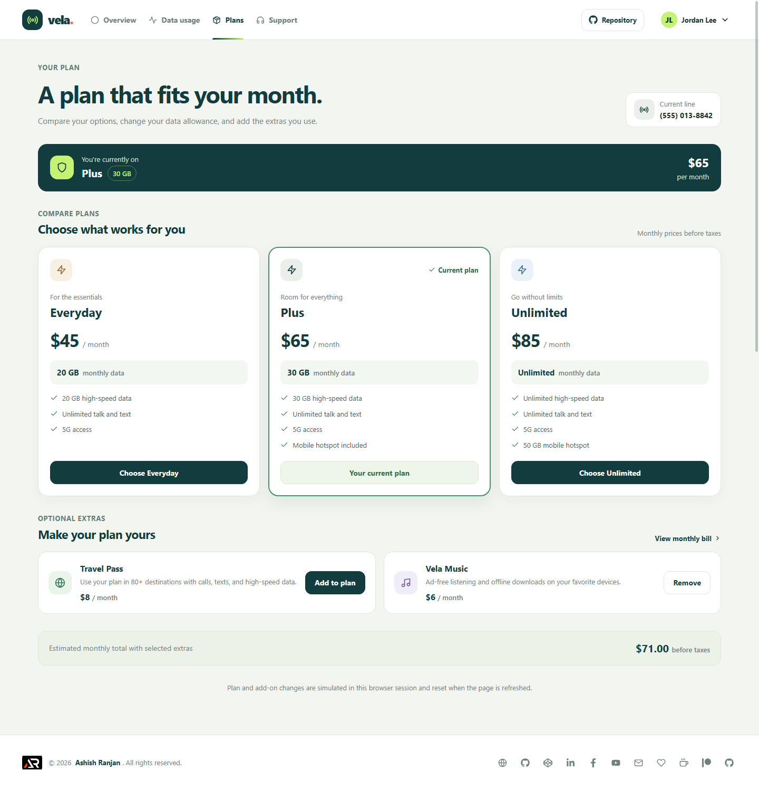 |
| Support cases | 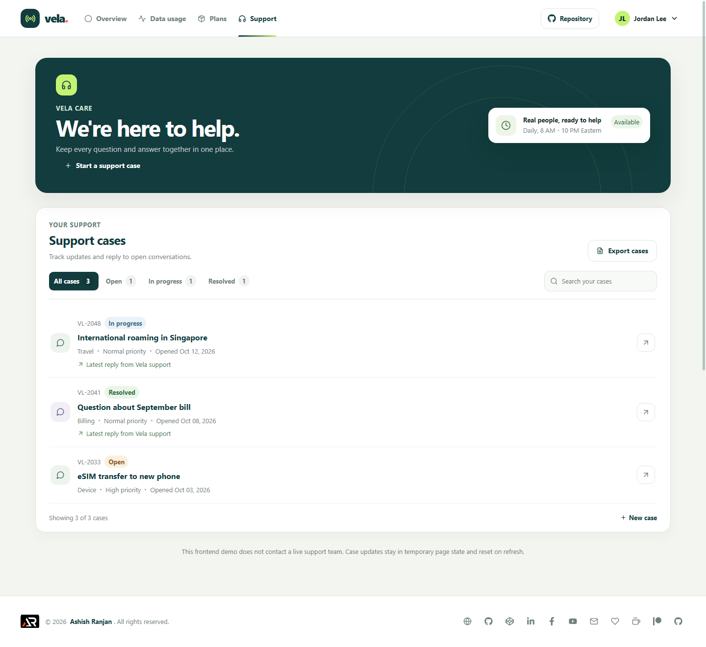 |

### Dialogs

| Dialog state | Screenshot |
| --- | --- |
| Review sample payment | 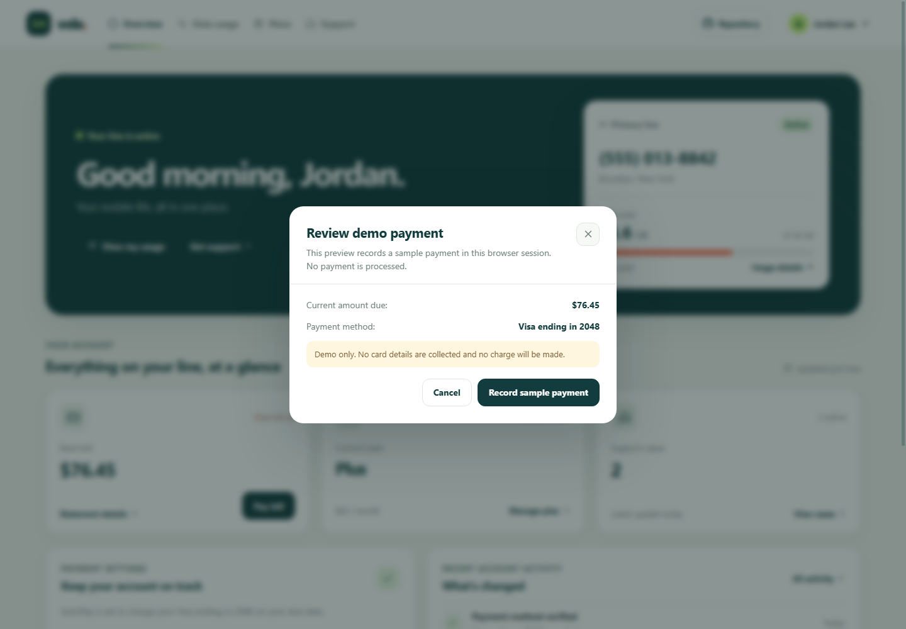 |
| Statement details | 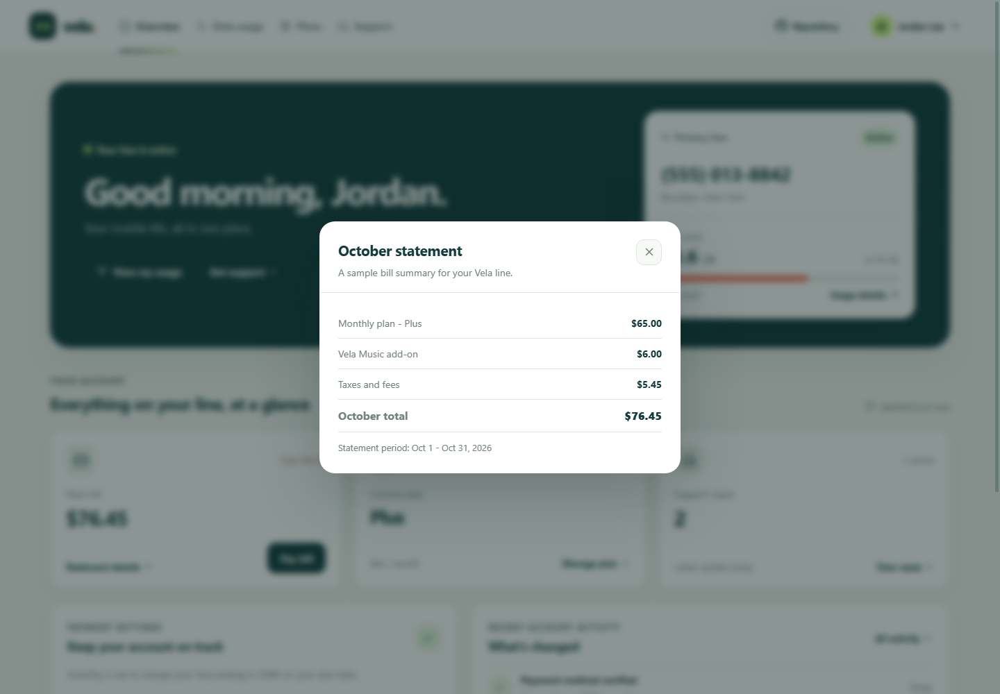 |
| Saved payment method | 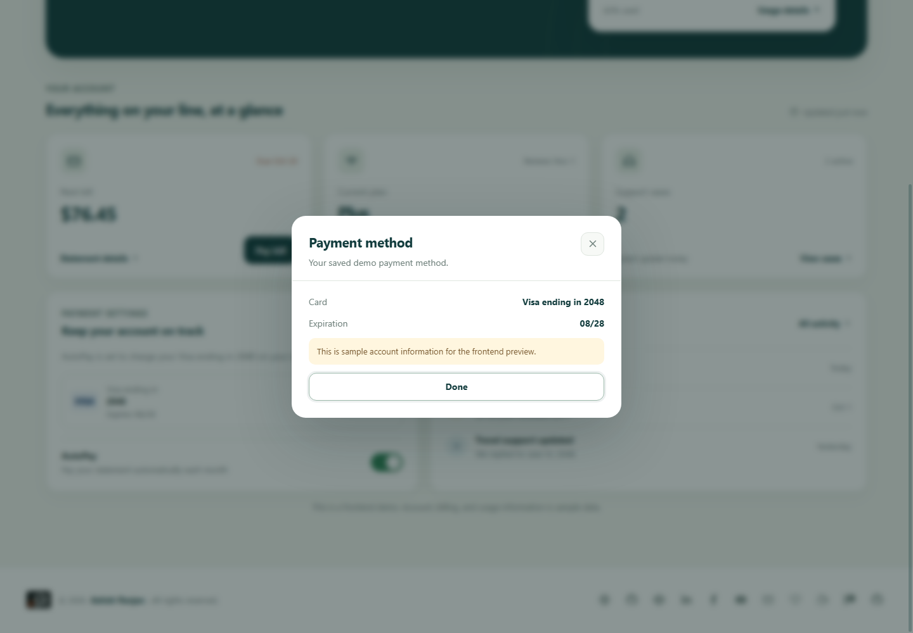 |
| Confirm plan change | 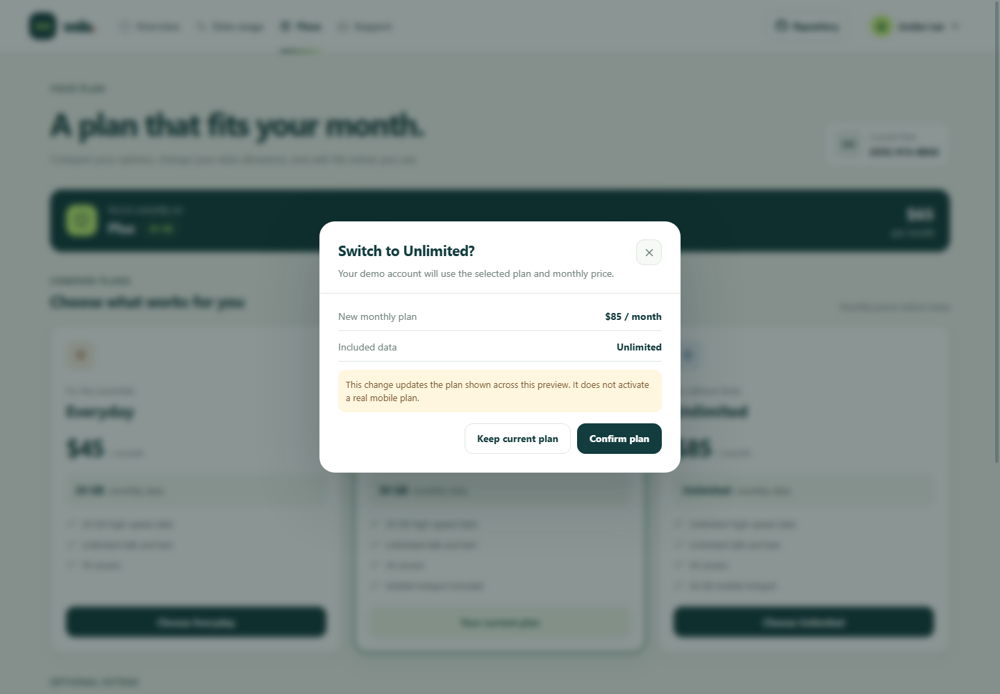 |
| New support case | 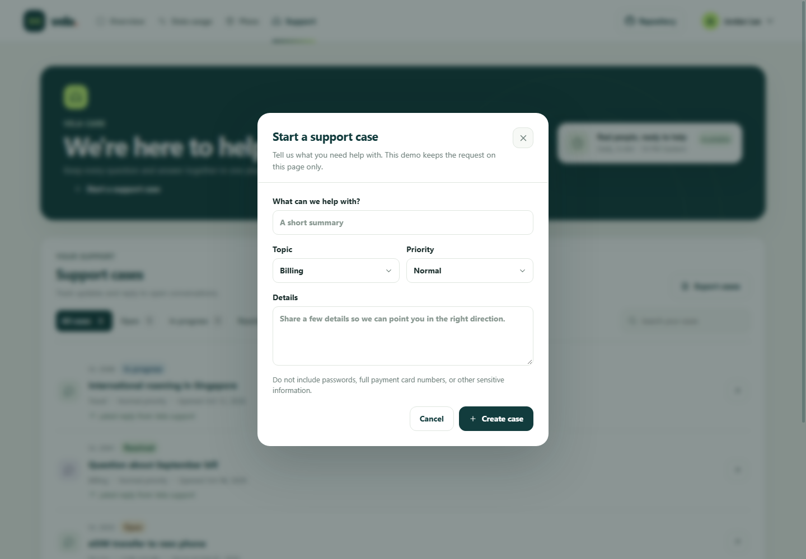 |
| New support case with details | 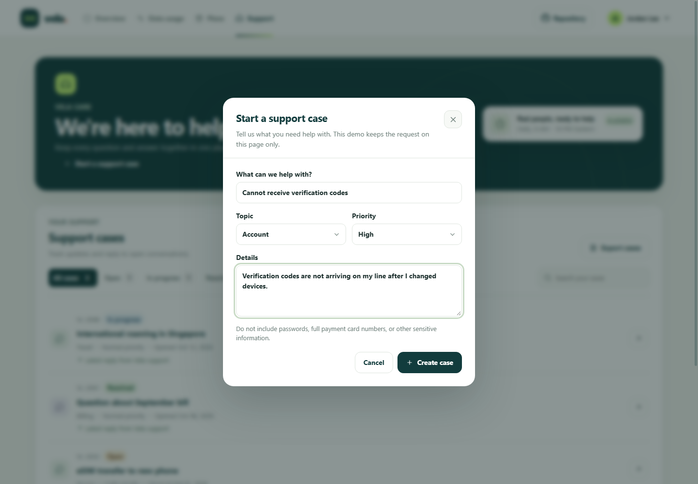 |
| Reply to a support case | 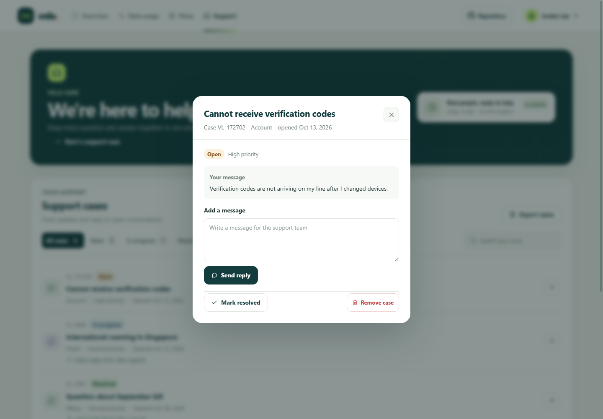 |
| Support case with response | 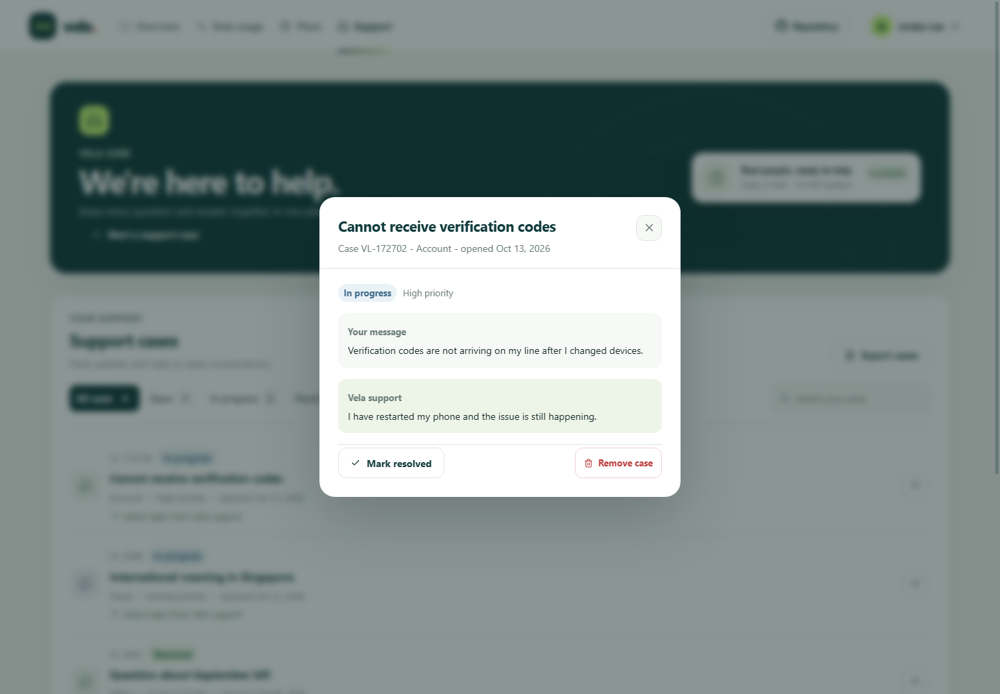 |
| Remove support case confirmation | 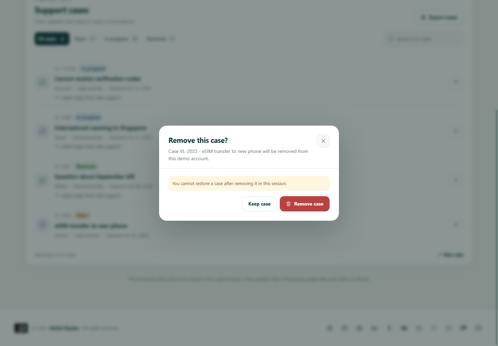 |

## Future improvements

These extensions need a real service or an external provider and are not implemented in this frontend demo:

- Connect account, plan, usage, and bill data to a carrier API and authenticated customer accounts.
- Process real payments through a payment provider and manage payment methods securely.
- Store support cases on a server and deliver responses and account notifications through production services.

## Links

- Portfolio: [https://www.ashishranjan.net](https://www.ashishranjan.net)
- GitHub: [https://github.com/a2rp](https://github.com/a2rp)
- CodePen: [https://codepen.io/ash1198](https://codepen.io/ash1198)
- LinkedIn: [https://www.linkedin.com/in/aashishranjan](https://www.linkedin.com/in/aashishranjan)
- Facebook: [https://www.facebook.com/theash.ashish/](https://www.facebook.com/theash.ashish/)
- YouTube: [https://www.youtube.com/@ashishranjan-ashz?sub_confirmation=1](https://www.youtube.com/@ashishranjan-ashz?sub_confirmation=1)
- Email: [mailto:ash.ranjan09@gmail.com](mailto:ash.ranjan09@gmail.com)

## Support

- Support: [https://a2rp-donation-page.netlify.app/](https://a2rp-donation-page.netlify.app/)
- Buy Me a Coffee: [https://buymeacoffee.com/ashishranjan](https://buymeacoffee.com/ashishranjan)
- Patreon: [https://www.patreon.com/ashishranjan](https://www.patreon.com/ashishranjan)